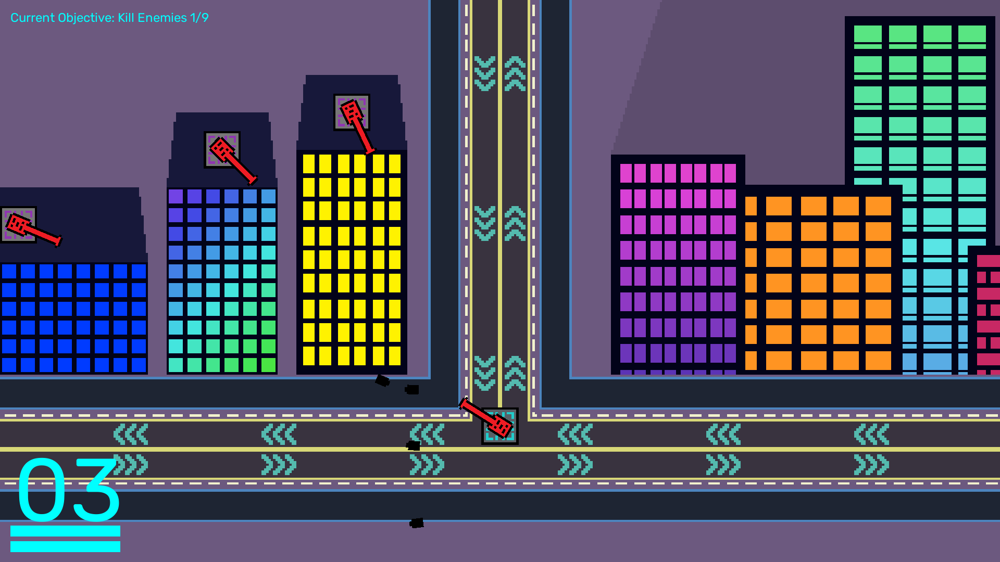

# Temporal Nexus

A top-down 2D shooter built with GameMaker Studio 2.

## About

Originally completed in May 2025 for the DPCDSB Game Development Contest.

Built entirely in GameMaker Studio 2.

## Preview

## Features

- Player movement and shooting
- Advanced enemy AI using a state machine
- Complete UI including HUD, settings, and pause menu
- Time-warping gameplay mechanics
- Replay system
- Weapon switching, dropping, and throwing
- Dynamic shadow casting
- Enemy bullet dodging
- Death, attack, and bullet impact visual effects
- Original maps and textures
